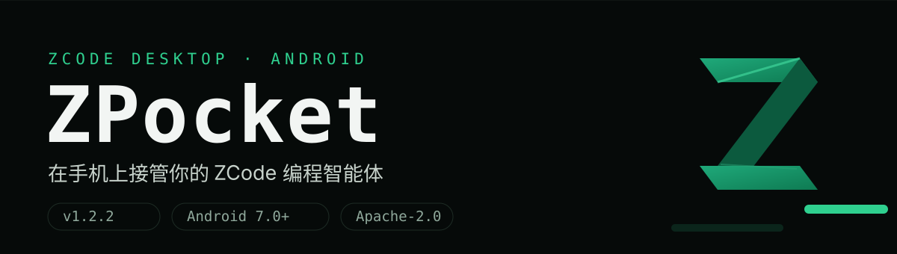
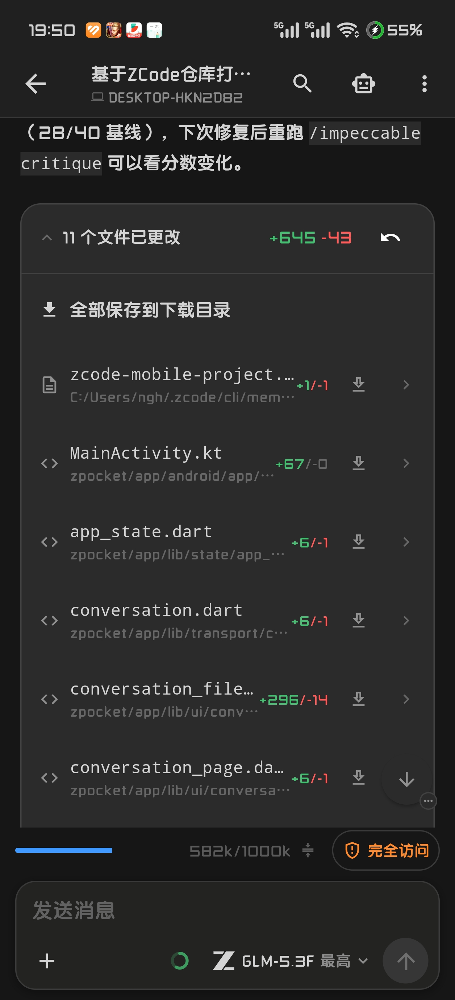
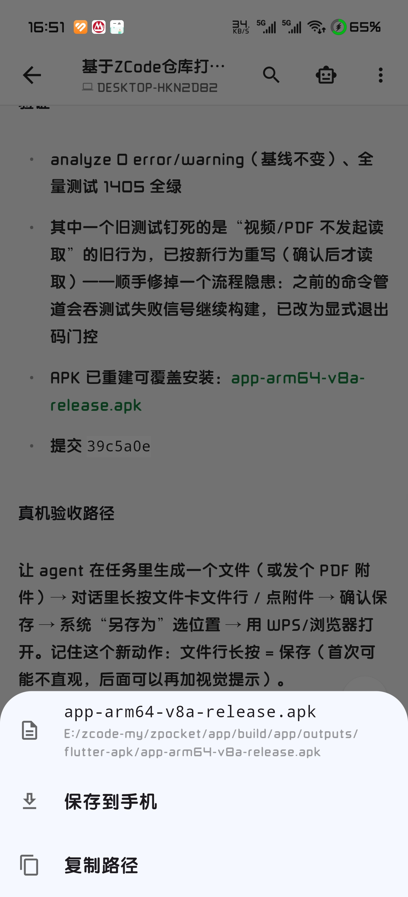
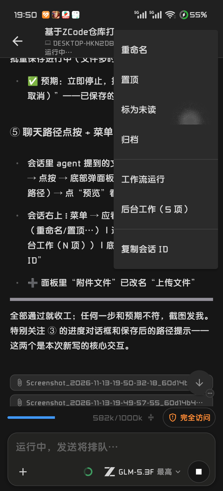

<div align="center">



[简体中文](README.md) | **English**

</div>

---

**ZPocket** is an Android companion client for the [ZCode](https://github.com/zai-org/ZCode) desktop coding agent — review tasks, approve permissions, read sessions, and download the files your agent produces, straight to your phone.

> Forked from [zcode-pocket](https://github.com/JZYLukis/zcode-pocket) (Apache-2.0) with an independent update channel and roadmap. Current release: v1.2.2. 中文文档见 [README.md](README.md)。

| Artifacts · one-tap save | Tap file paths in chat | Session menu |
| --- | --- | --- |
|  |  |  |

## Highlights

- **Full session control on the go** — live task status, one-tap permission approvals, streaming output
- **Take the artifacts with you** — per-file and batch download of workspace files into your phone's `Downloads/ZPocket/`, with progress and cancel
- **Tap-able file paths** — file paths mentioned by the agent open an action sheet: preview / save / copy path
- **Self-hosted update channel** — update manifest and APKs are served from your own server; in-app one-tap updates with SHA-256 + signature verification

## Requirements

- Android 7.0+
- A desktop running [ZCode](https://github.com/zai-org/ZCode), signed in with the same account

## Build

```bash
# Flutter 3.47+ / JDK 17 / Android SDK
flutter build apk --release --split-per-abi
```

See the [Chinese README](README.md) for the self-hosted update channel, release tooling, and design docs.

## Credits & License

Apache-2.0. Built on [zcode-pocket](https://github.com/JZYLukis/zcode-pocket) — the protocol implementation and most of the UI come from it; upstream updates are merged via the `upstream` remote. ZCode itself is [zai-org/ZCode](https://github.com/zai-org/ZCode). See [LICENSE](LICENSE), [THIRD-PARTY-NOTICES.md](app/THIRD-PARTY-NOTICES.md) and [NOTICE-ZCode.md](app/NOTICE-ZCode.md).
