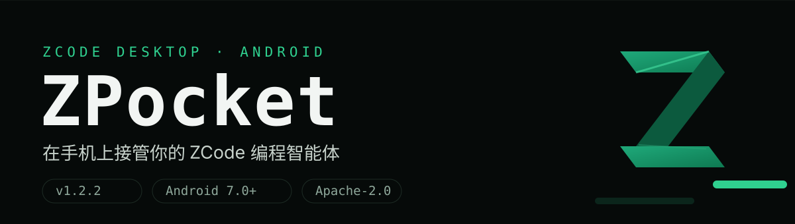
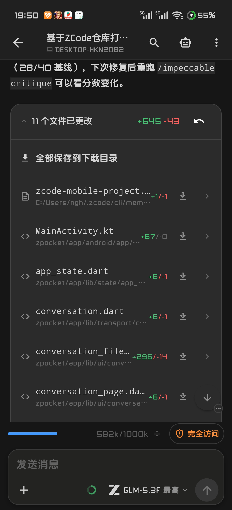
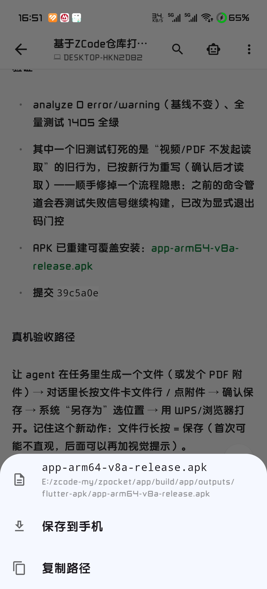
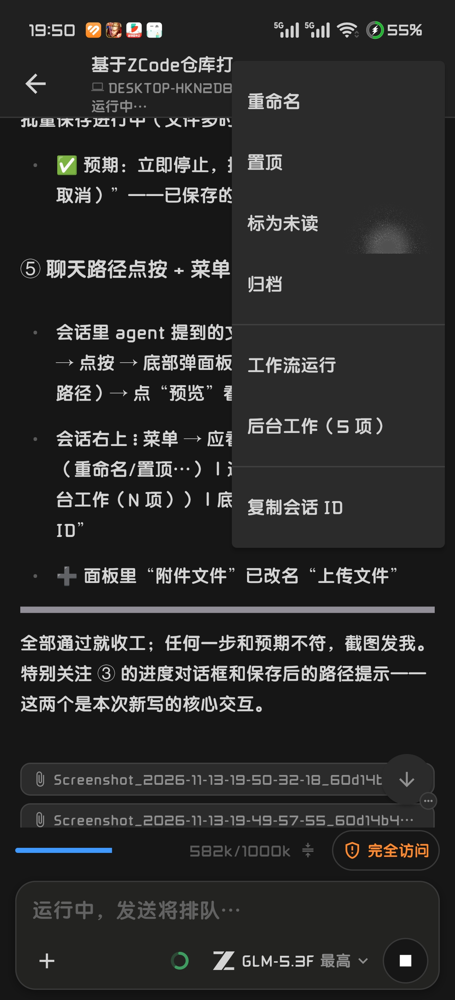
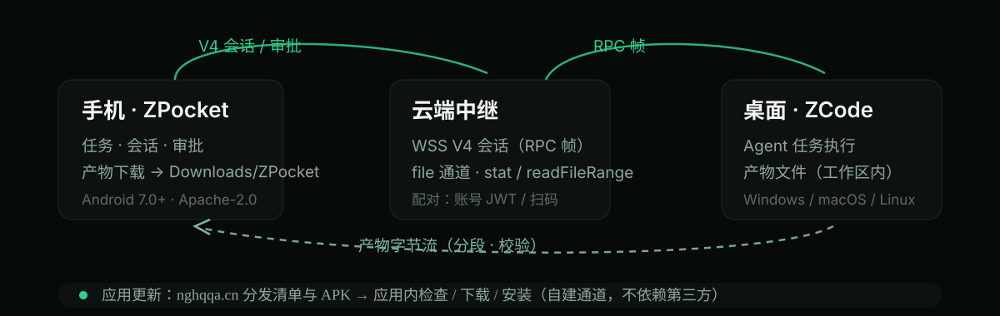

<div align="center">



**[English](README.en.md)** | 简体中文

</div>

---

ZPocket 是 [ZCode](https://github.com/zai-org/ZCode) 桌面编程智能体的**安卓伴侣客户端**：在手机上查看任务、审批权限、浏览会话，并把 agent 产出的文件一键保存到手机。

> 基于 [zcode-pocket](https://github.com/JZYLukis/zcode-pocket)（Apache-2.0）fork 而来，更新通道与产品方向独立维护。当前版本 v1.2.2。

| 产物文件 · 一键保存 | 聊天内路径点按 | 会话菜单 |
| --- | --- | --- |
|  |  |  |

## 它解决什么问题

桌面端的 ZCode 在电脑上干活，但人不在电脑前：

- **审批不能等**——agent 卡在权限确认上，任务就停在那里
- **产物拿不走**——agent 生成的文件在电脑磁盘里，手机上拿不到
- **进度看不见**——出门在外，不知道任务跑没跑完

ZPocket 把这三件事搬进手机：连接桌面端后，任务状态实时可见、权限一键审批、产物文件直接下载到手机存储。

## 工作原理



- **会话链路**：手机 ⇄ 云端中继 ⇄ 桌面端，WSS + V4 会话协议（RPC 帧），配对凭据为账号 JWT 或扫码
- **文件下载**：`file` 通道 `stat` + `readFileRange` 分段拉取，SHA-256 校验语义与桌面端一致
- **更新通道**：自建——清单与 APK 由自有服务器分发，应用内一键检查更新，不依赖第三方

## 安装

要求：Android 7.0+，桌面端已登录 [ZCode](https://github.com/zai-org/ZCode) 且手机使用同一账号。

1. 下载最新 APK：`https://nghqqa.cn/updates/zpocket-<version>-arm64-v8a.apk`（绝大多数手机）
2. 或在 App 内：**设置 → 软件更新 → 一键更新**
3. 首次使用：登录账号 → 从设备列表选择你的电脑（或扫码配对）

> 更新清单与 APK 由自托管服务分发（见 [`tools/release.py`](tools/release.py)），不依赖任何第三方发布平台。

## 从源码构建

```bash
# 依赖：Flutter 3.47+ / JDK 17 / Android SDK
flutter build apk --release --split-per-abi

# 发版（bump 版本 → 构建 → 生成更新清单 → 上传提示）
python tools/release.py --version 1.2.3 --notes "…" --base-url https://your-host/updates
```

工具链：[`tools/gen_icon.py`](tools/gen_icon.py)（图标生成）、[`tools/l10n_missing.py`](tools/l10n_missing.py)（本地化完整性检查）、`.zcode/workflows/`（测试验证工作流）。

## 质量与守护

- 1400+ 测试全绿（继承上游 184 个测试文件的守护文化）
- 新增守卫：文件卡触控目标 ≥44dp、路径双分隔符提取、批量保存通道接线
- 本地化完整性检查可复跑，缺失即失败

## 与上游的关系

- **上游**：[zcode-pocket](https://github.com/JZYLukis/zcode-pocket)（本项目的直接基线，Apache-2.0）——协议实现与大部分 UI 出自它，上游更新通过 `upstream` remote 合并跟进
- **官方**：[zai-org/ZCode](https://github.com/zai-org/ZCode)（ZCode 桌面端本体）
- **本 fork 的独立部分**：自建更新通道、文件下载/批量保存、聊天路径点按、品牌与图标、中文本地化补全
- 协议与桌面端的兼容性跟随上游与官方桌面端版本演进

## 许可证

Apache-2.0。继承并保留上游 [zcode-pocket](https://github.com/JZYLukis/zcode-pocket) 与 [zai-org/ZCode](https://github.com/zai-org/ZCode) 的全部版权与声明，详见 [LICENSE](LICENSE)、[THIRD-PARTY-NOTICES.md](app/THIRD-PARTY-NOTICES.md) 与 [NOTICE-ZCode.md](app/NOTICE-ZCode.md)。
